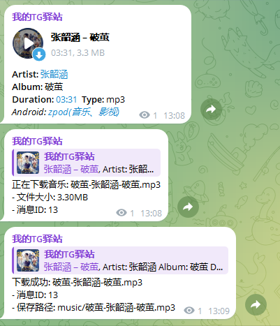
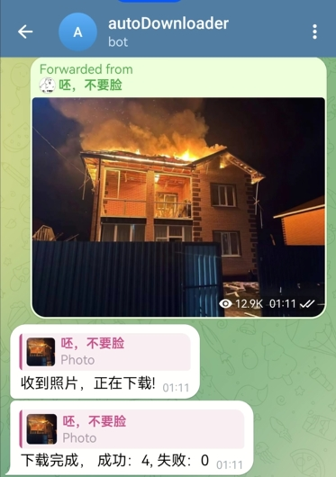
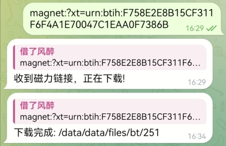
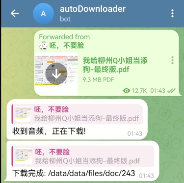
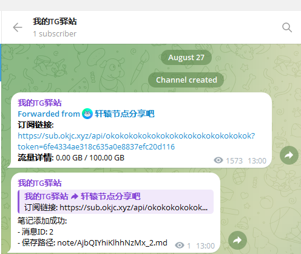
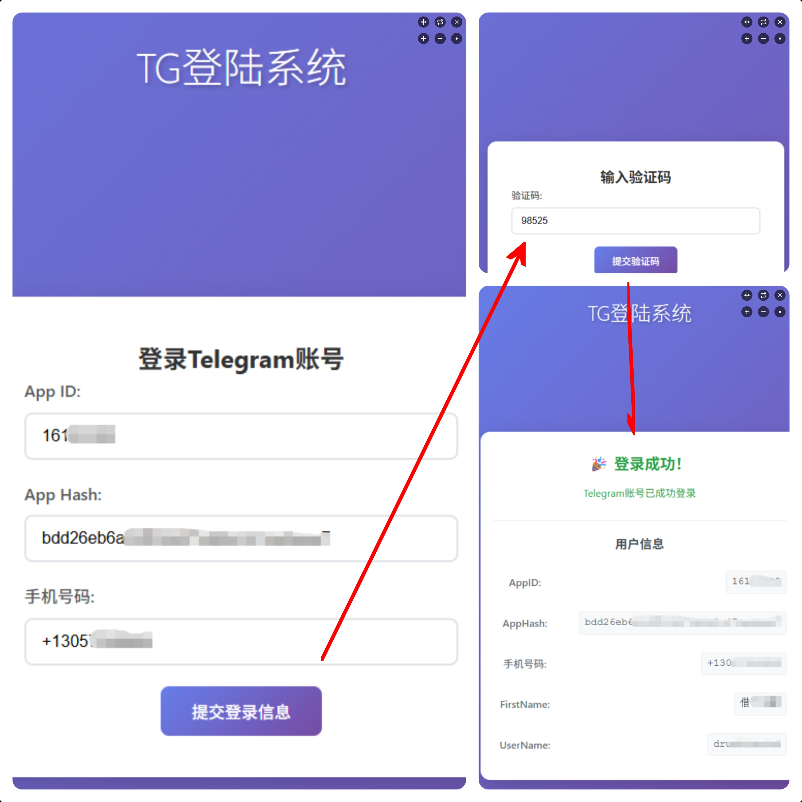

# tgautodown
一款用于下载TG上视频、音乐、图片、文档、磁力链的TG机器人；只需将所需的资源转发给机器人，机器人会自动完成下载，并且会在完成后回复消息通知你。

### 最新版本全新升级
- 采用全新架构，完全重写
- 不再依赖机器人
- 不再依赖bot-api-server
- 支持获取视频、文档、音乐原文件名

# TG截图
- 下载视频


- 下载音乐


- 下载图片


- 下载磁力链


- 下载文档


- 笔记摘抄


# 编译安装
项目纯go实现，直接拉代码编译：
```
git clone https://github.com/nasbump/tgautodown.git
cd tgautodown
go build
```

# 启动
- 启动参数：仅支持 `-cfg` 与 `-h/-help`（`--` 前缀等价），其余配置项全部通过配置文件设置；未知参数会报错并以退出码 2 退出
```
$ ./tgautodown -h
usage: ./tgautodown options
  -cfg /app/data/config.json  ## config file path
  -h    ## show this help, default false
  -help    ## same as -h, default false
```
- 配置文件示例（默认路径 `/app/data/config.json`，可通过 `-cfg` 指定）
```
{
  "cfgdir": "/app/data",
  "saveDir": "/app/download",
  "gopeed": "/app/bin/gopeed",
  "httpaddr": ":2020",
  "channels": [
    { "name": "频道1名称", "id": "频道1用户名或+邀请码", "slashcmd": true },
    { "name": "频道2名称", "id": "频道2用户名或+邀请码", "slashcmd": false }
  ],
  "proxy": "socks5://127.0.0.1:1080",
  "f2a": "",
  "retrycnt": 10,
  "retrysec": 0,
  "maxdl": 2,
  "logpath": "",
  "loglev": 0,
  "logsize": 314572800,
  "logcnt": 1
}
```
| 配置项 | 说明 |
| --- | --- |
| `cfgdir` | `session.json`、`tasks.json` 的保存目录 |
| `saveDir` | 下载文件保存根目录 |
| `gopeed` | BT 下载命令路径 |
| `httpaddr` | Web 服务监听地址 |
| `channels` | 订阅的频道/群组数组，见下表 |
| `proxy` | socks5 代理地址，留空表示不使用代理 |
| `f2a` | 两步认证密码，未开启则留空 |
| `retrycnt` | 失败时最大重试次数，0 表示不限制 |
| `retrysec` | 单文件失败最大重试时长（秒），0 表示不限制 |
| `maxdl` | 同时下载的任务数，默认 1；超出部分自动排队 |
| `logpath` | 日志文件路径，留空输出到标准输出 |
| `loglev` | 日志级别：-1 trace, 0 debug, 1 info, 2 warn, 3 error |
| `logsize` | 单个日志文件大小上限，单位字节 |
| `logcnt` | 日志文件保留数量 |

`channels` 数组元素：

| 字段 | 说明 |
| --- | --- |
| `name` | 可读的频道名称，用于日志与回执展示；留空时回退为 `id` |
| `id` | 频道标识：公开频道/群组写用户名，私有频道/群组写 `+邀请码` |
| `slashcmd` | 是否在该频道内响应斜杠命令（`/queue`、`/pause` 等），默认 `false` |


### 启动示例：
```
./build/tgautodown -cfg /app/data/config.json
```

### 首次启动需要登陆TG
- 浏览器打开： http://<IP>:2020
- 参考下图流程完成登陆，以后就可以不用再登陆了


### 下载保存路径：
视频、音乐、文档、图片、磁力链、笔记分别保存在`videos`,`music`,`documents`,`photos`,`bt`,`note`目录下。

### 下载队列与任务管理
文件下载（视频、音乐、文档、图片）统一进入下载队列，每个任务都有唯一的递增任务ID：

- 同时下载数由配置项 `maxdl` 控制，超出的任务自动排队
- 下载失败会自动重试1次，仍失败则降低优先级重新排队；超过 `retrycnt` 后标记为失败
- 排队中的任务出队时会自动刷新文件引用（FileReference），避免因过期导致下载失败
- 任务支持断点续传：未下载完的文件以 `.dl` 后缀保存，中断后继续下载
- 排队中、下载中、已暂停的任务会落盘到 `配置文件目录/tasks.json`，程序重启后自动恢复
- 在TG中向 `channels` 里 `slashcmd` 为 `true` 的频道发送以下斜杠命令管理任务：

```
/queue           查看任务列表：任务ID、状态、进度、文件名
/pause <任务ID>   暂停任务（保留断点）
/start <任务ID>   恢复已暂停的任务
/delete <任务ID>  删除任务，保留已下载的文件
/destroy <任务ID> 删除任务，同时删除已下载的文件
/help            查看帮助
```

- 其他
1. appid和apphash获取：https://core.telegram.org/api/obtaining_api_id

# docker启动
- docker-compose（所有配置放在挂载的 `config.json` 中，容器只需指定 `-cfg`）：
```
services:
  tgautodown:
    image: nasbump/tgautodown:latest
    container_name: tgautodown
    restart: unless-stopped
    command: ["-cfg", "/app/data/config.json"]
    ports:
      - 2020:2020
    volumes:
      - /mnt/sda1/download:/app/download
      - /mnt/sda1/data:/app/data
```
- 需提前在 `/mnt/sda1/data/config.json` 中准备好配置，例如：
```
{
  "channels":[
    { "name": "频道1名称", "id": "+AjbQIYhiKlhhNzMx", "slashcmd": true }
  ],
  "proxy":"socks5://192.168.31.2:7891",
  "f2a":"f2apassword",
  "retrycnt":10
}
```


# 感谢
- [基于MTProto协议的TG库](github.com/gotd/td/tg)
- [下载：gopeed](https://github.com/GopeedLab/gopeed)
